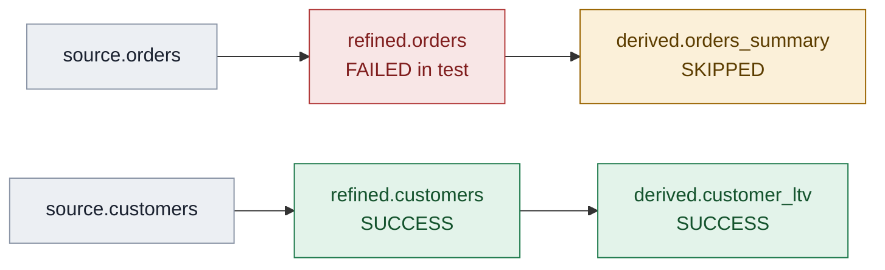

# DAG

clair shows your project as a directed acyclic graph (DAG). Each node is a Trouve. Each
edge tells that one Trouve reads another. clair runs the nodes in that order, and you
write no list of dependencies.

## Where an edge comes from

An edge comes from a reference: a Trouve object inside an f-string, or in a list of
inputs.

| You write | Edge |
|-----------|------|
| `sql=f"SELECT * FROM {orders}"` | Yes |
| `sample_sql=f"SELECT * FROM {THIS} WHERE id IN (SELECT id FROM {test_users})"` | Yes, to `test_users` |
| `PandasTable(inputs=[orders])` | Yes |
| `from db.schema.orders import trouve as orders`, with no reference | No |
| `TestSql(sql=f"SELECT * FROM {THIS} JOIN {customers} ...")` | Yes, a test edge |

An `import` alone adds no edge, because the import only gives you the object. The
reference tells clair where the SQL reads.

A `TestSql` reference adds a test edge. The build of the Trouve does not read the other
Trouve, but its test does, and the test runs before the promotion. Thus the run treats a
test edge as any other edge: the Trouve waits for the Trouve that its test reads, and a
failure of that Trouve skips it. A Source runs no test, thus its tests add no edge.

## How clair builds the DAG

Each command that reads the project starts with discovery:

1. It walks the project directory. It reads each `.py` file with a name that does not
   start with `_`. It skips each directory with a name that starts with `.` or `_`, and
   each virtual environment (a directory that holds `pyvenv.cfg`).
2. It imports each file. A file that declares a `trouve` object is a Trouve, and its path
   gives the address `database.schema.table`. See [Project Layout](project-layout.md).
3. It reads each reference, and adds one edge for each reference.
4. It looks for a cycle. A cycle stops the command with `CyclicDependencyError`.

`__database_config__.py` and `__schema_config__.py` start with `_`, thus discovery reads
them as configuration and not as Trouves. See
[Per-Database & Schema Config](per-database-schema-config.md).

## Run order

clair runs each Trouve after each Trouve that it reads. A failure stops one branch, and
not the run. If a Trouve fails, clair skips each Trouve downstream of it, and continues
with each other branch. Here a test of `refined.orders` fails:



- `refined.orders` keeps its production data. The rejected candidate stays at its staging
  address, for you to query.
- `derived.orders_summary` does not run, because its input did not change.
- The customers branch runs to the end.
- The run ends with `=== Done: 2 succeeded, 1 failed, 1 skipped ===`, and the status code 1.

## Read the DAG

`clair dag` prints the tree. It needs no Snowflake connection.

```
$ clair dag
=== Clair DAG: 3 Trouves, 1 source ===

example_1_database.source.events  [SOURCE]
└── example_1_database.refined.events  [TABLE]
    └── example_1_database.derived.daily_event_counts  [TABLE]
        └── example_1_database.derived.top_event_types  [TABLE]
```

`--select` shows each Trouve that a pattern selects, and each Trouve above it. It takes
the patterns of [Selectors](selectors.md).

```bash
clair dag --select='example_1_database.refined.events+'
```

## Artifacts

`clair compile` and `clair run` write to `_clairtifacts/<run_id>/`. The tree has the shape
of the project. A SOURCE gets no file, because clair writes nothing to it.

```
_clairtifacts/
└── 019607ab3e8a7f1c8b2d4e6f0a1b2c3d/   ← the run_id, a UUIDv7
    ├── refined/
    │   └── orders/
    │       └── daily.sql
    └── run_summary.json                ← clair run only
```

- `clair compile` writes the plan of each Trouve, one file for each Trouve. A SQL Trouve
  gets a `.sql` file. A pandas Trouve gets a `.py` file: its Python code sits at the build
  phase, and each SQL statement of the plan is a comment, in the order of the run.
- `clair run` writes the `.sql` file of a Trouve when the Trouve completes. The file holds
  each statement, with its status, its query ID and its error. A skipped Trouve gets no
  file. At the end, `clair run` writes `run_summary.json`, the complete `RunSummary`.
- The Python API writes no file. To write the artifacts from a notebook, see
  [Artifacts](../reference/python-api.md#artifacts).

Add `_clairtifacts/` to your `.gitignore`. `clair init` does this for you.
